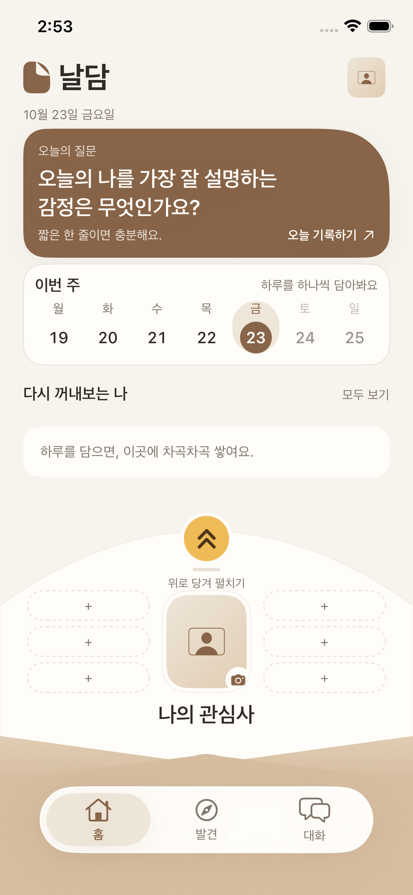
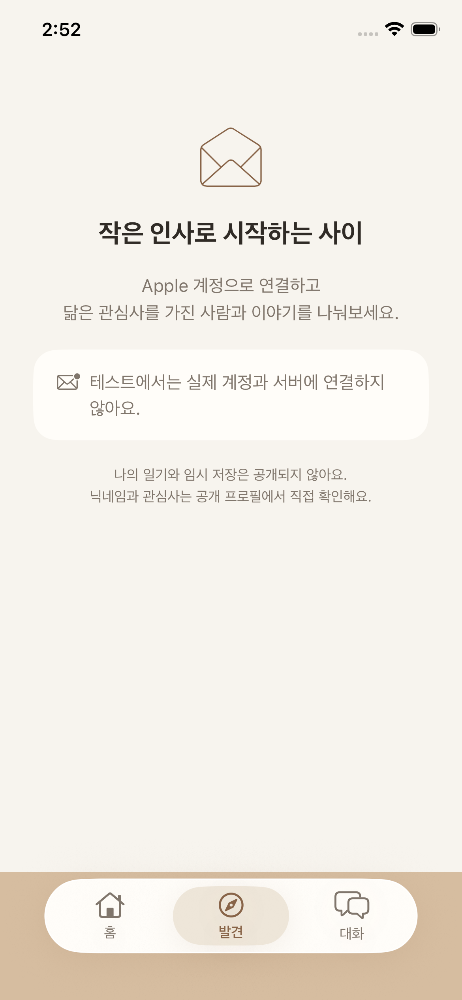

# Apple 로그인 · 1:1 채팅 연결 검증

이슈 #18의 구현 화면입니다. #17의 봉투 UI 위에 Firebase Authentication과 Firestore를 연결했습니다.

## 실제 시뮬레이터 캡처

Xcode 27.1, iPhone 17e, iOS 26.5에서 UI 테스트 중 캡처했습니다.

| 홈 UI 유지 | 로그인 전 연결 안내 |
| --- | --- |
|  |  |

UI 테스트에서는 실제 Firebase 프로젝트에 연결하지 않습니다. 오른쪽은 설정 전 안내 상태이며, 유효한 설정 파일을 넣은 일반 실행에서는 네이티브 Apple 로그인 버튼이 표시됩니다. 실제 Apple 인증 성공 화면이나 두 실기기 간 메시지 전달을 촬영한 자료는 아닙니다.

## 확인한 범위

- 단위 테스트 32개 통과: 기존 기록, 계정별 초안과 미전송 메시지 복원, 재시도 ID, 입력 경계, 로그인 nonce와 설정 검사.
- UI 테스트 8개 통과: 홈·기록·봉투·사진·최근 기록 5개와 로그인 전 발견/대화 진입. 마지막 보완 후 단위 32개와 로그인 UI 2개 재검증 통과.
- Firestore 에뮬레이터 테스트 16개 통과: 두 인증 클라이언트의 실시간 왕복, 요청 수신자만 수락, 제3자 접근 및 발신자 위조 차단, 차단 후 전송 제한, 계정별 읽음 상태, 중복 없는 재시도.
- iOS 실기기 대상 Release 빌드 통과(코드 서명 제외). Apple 개발자 팀의 실제 서명·설치는 별도 확인이 필요합니다.

실제 Firebase 프로젝트에 규칙을 배포하지 않았습니다. [설정 안내](../../../docs/FIREBASE_SETUP.md)에 따라 프로젝트·Apple 개발자 설정을 마친 뒤 서로 다른 Apple 계정을 쓰는 iPhone 두 대에서 로그인과 왕복 전송을 확인해야 합니다.
