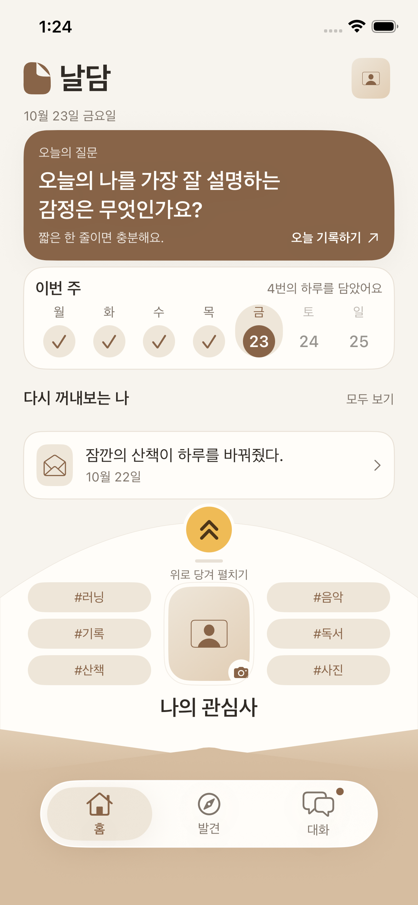
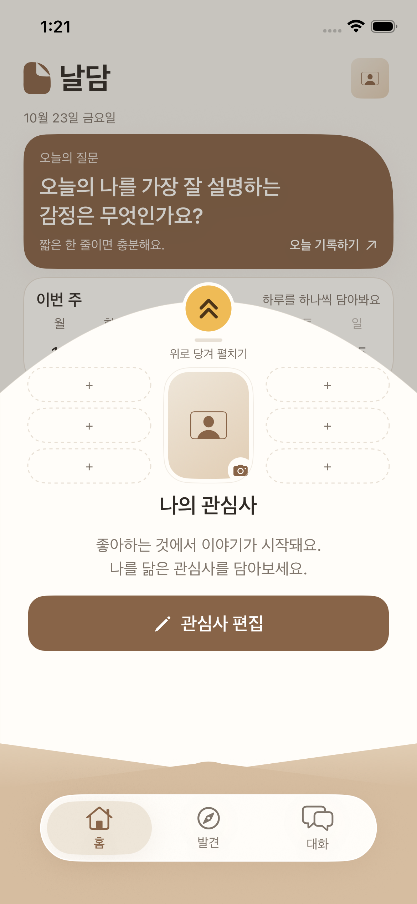
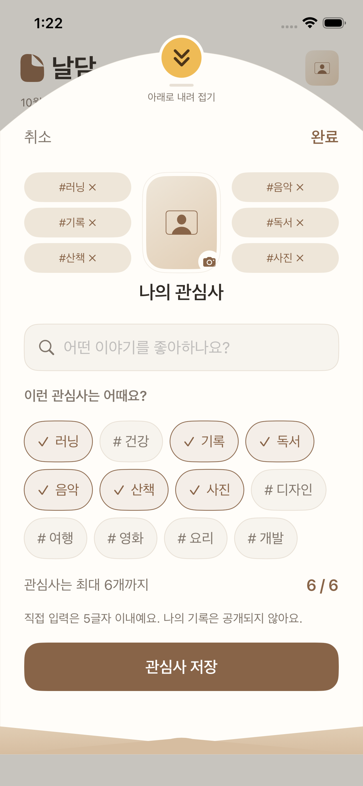
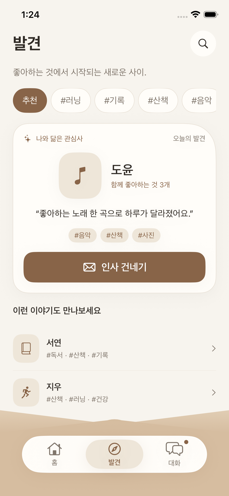
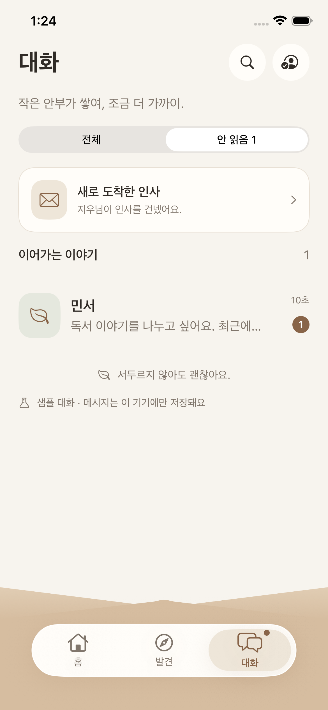
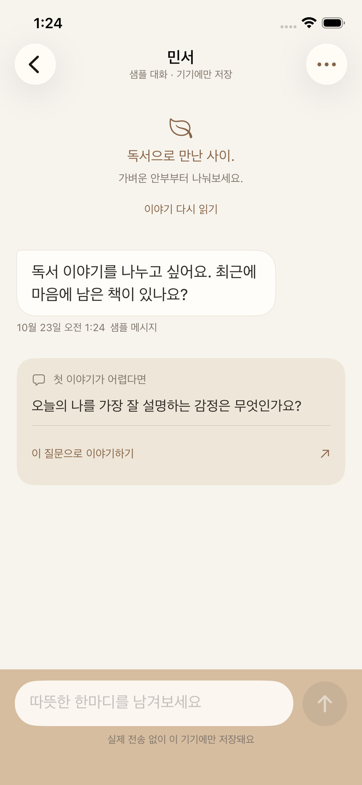

# 봉투 배경과 발견·대화 UI 개편

이슈 #16, 작업 브랜치 `feat/#16-envelopeUIRefresh`에서 선택한 발견·대화 시안을 SwiftUI에 반영했습니다. `setting/#7-integrationTests`에서 시작해 코드가 동일한 최신 develop 통합 커밋을 반영했습니다.

## 화면과 동작

- 갈색 봉투 배경이 흰색 캡슐 탭바 뒤와 하단 안전 영역까지 이어집니다. 탭마다 독립적인 NavigationStack을 유지하고, 종이·접힌 선·탭바는 위에서 아래로 배치해 서로 겹치지 않습니다. 봉투에는 브랜드 텍스트를 넣지 않습니다.
- 홈은 질문 카드, 이번 주 기록, 최근 저장 기록 최대 5개를 세로로 쌓습니다. 최근 항목은 날짜순이며 빈 답변과 미래 기록은 표시하지 않고, 같은 날짜가 중복된 경우 최신 수정본만 사용합니다. 항목을 누르면 해당 날짜의 실제 기록으로 이동합니다.
- 관심사 봉투는 중앙 사진과 좌우 3칸씩 총 6칸으로 구성합니다. 하나의 관심사가 양쪽에 중복해서 나타나지 않습니다. 기존의 3단계 전환, 취소와 명시적 저장, 큰 글자용 대체 배치를 유지합니다.
- 중앙 사진을 누르면 시스템 사진 선택기가 열립니다. 선택한 사진은 바로 반영되고, 내 프로필에서 변경·삭제할 수 있습니다.
- 검색 결과가 없으면 입력한 관심사를 직접 추가할 수 있습니다. 앞뒤 공백과 `#`를 정리한 문자열이 1~5글자인 경우에만 추가 버튼을 활성화합니다. 전체 선택은 서로 다른 관심사 최대 6개로 제한합니다. 한글과 조합 이모지는 사용자가 보는 문자 수로 셉니다.
- 발견은 관심사 필터, 추천 프로필 카드, 다른 이야기 목록과 인사 진입을 제공합니다. 저장한 관심사와 겹치는 항목이 많은 프로필을 우선합니다.
- 대화 목록은 새로 온 인사와 이어가는 대화를 구분하고, 전체·안 읽음 필터를 제공합니다. 검색, 요청 수락·거절, 차단과 보관 기능을 유지합니다.
- 개별 대화는 공통 관심사 안내, 종이·갈색 말풍선, 갈색 입력 영역으로 구성합니다. 초안이 비어 있을 때 첫 질문을 제안하고, 질문을 눌러도 메시지는 자동 발송되지 않습니다.
- 관심사 전체 편집과 상세 화면에서는 캡슐 탭바를 숨기고, 뒤로 돌아오면 복원합니다. 홈의 기록 스크롤은 봉투 위에서 끝나므로 곡선 양옆으로 뒷 카드가 비쳐 보이지 않습니다. 발견·대화 제목은 화면 본문에 배치해 잘리지 않도록 합니다.

## 저장과 호환성

`QuizEntry`, `JournalDraft`, `InterestSelection`의 저장 스키마와 기존 사회 기능 JSON 형식은 변경하지 않습니다. 태그 정리는 표시와 명시적 저장 경로에 적용하며 기존 저장소를 일괄 수정하지 않습니다. 사진은 최대 600픽셀 JPEG로 변환해 UserDefaults의 `profilePhotoJPEG`에 저장합니다.

발견과 대화는 기존과 동일하게 로컬 샘플입니다. 개인 기록이나 선택한 프로필 사진을 서버로 전송하지 않습니다. QA용 기록과 대화는 Debug 빌드의 전용 인자를 사용하며 일반 저장소와 격리됩니다.

## 검증

단위 테스트는 태그 중복·글자 수·직접 추가한 태그 검색, 최근 5개 날짜 선택, 사진 변환을 검사합니다. UI 회귀 테스트는 기존 기록 저장·봉투·대화·큰 글자 흐름과 함께 고유 슬롯, 사용자 태그 제한, 최근 기록 직접 이동, 읽지 않음 필터와 질문 초안을 확인합니다. 전용 QA 사진을 사용해 시스템 사진 선택도 검증합니다.

### 실행 결과

- 환경: Xcode 27.1, iPhone 17e 시뮬레이터 / iOS 26.5
- 단위 테스트 24개, UI 회귀 테스트 8개 통과
- 관심사 편집 배치를 다듬은 후 단위 테스트 24개와 관련 UI 3개 재검증 통과
- 홈 간격과 아이콘을 마무리한 후 기록 저장·홈/탭 복귀 UI 2개 재검증 통과
- iOS 기기용 Release 빌드 통과 (`CODE_SIGNING_ALLOWED=NO`)
- 실기기 실행은 검증하지 않았습니다. 사진 선택 테스트는 전용 QA 시뮬레이터에 가져온 앱 아이콘 이미지를 사용했습니다.

### 실제 실행 화면

| 홈 | 관심사 중간 단계 | 관심사 전체 편집 |
| --- | --- | --- |
|  |  |  |

| 발견 | 대화 목록 | 개별 채팅 |
| --- | --- | --- |
|  |  |  |

[최근 5개 기록 스크롤](05-recent-five.png) · [시스템 사진 선택 후 반영](08-profile-photo.png)
